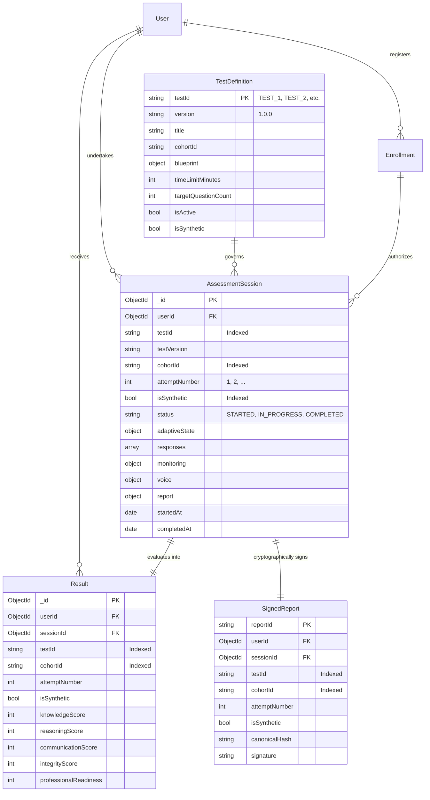
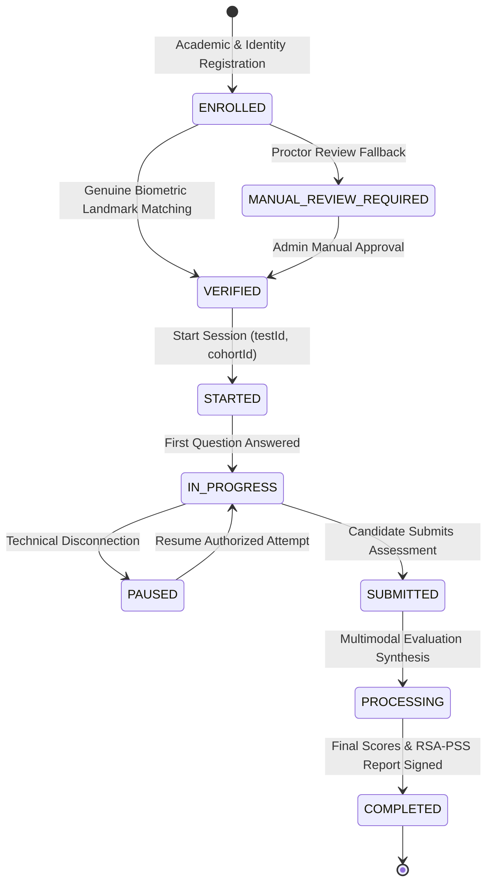

# Assessment Data Architecture & Dual-Test Lifecycle
## Multimodal Psychometric AI Assessment Platform (Phase-3)

**Version:** 3.0.0  
**Status:** Implemented, Migrated & Verified  
**Date:** October 28, 2026  

---

## 1. Overview & Dual-Test Architecture

To support paired cognitive research and controlled pilot evaluations (e.g. 150 engineering students), the assessment data model enforces immutable test-attempt isolation:
- **Test 1 (Pre-Assessment):** Evaluates baseline cognitive knowledge, analytical reasoning, and verbal fluency before training/intervention.
- **Test 2 (Post-Assessment):** Measures longitudinal progression, interview confidence, and cognitive adaptability.
- **Attempt Isolation Guarantee:** A candidate undertaking Test 2 creates an independent attempt document (`testId: "TEST_2", attemptNumber: 1`). Test 1 records (`testId: "TEST_1"`) are immutable and **never overwritten**.

---

## 2. Entity Relational & Schema Architecture



---

## 3. State Machine & Transition Rules



### Transition Integrity Guarantees
1. **Idempotent Finalization:** Multiple calls to `/api/assessment/submit` on a completed session return the existing `resultId` and `signedReportId` without mutating score data.
2. **Attempt Numbering:** Attempt numbers increment sequentially (`previousAttempts + 1`) per specific `testId`.
3. **Cohort Partitioning:** Independent cohorts (e.g., `COHORT_A`, `CONTROL_GROUP`) are partitioned via indexed fields.
4. **Synthetic Data Isolation:** Load test runs and integration fixtures tag records with `isSynthetic: true`, allowing clean exclusion from pilot research analytics.

---

## 4. Compound Index Optimization

The following production indexes are synchronized on MongoDB:

```javascript
// AssessmentSession
{ userId: 1, testId: 1, attemptNumber: 1 } // Unique lookup per participant test attempt
{ testId: 1, status: 1, createdAt: -1 }      // Examiner aggregate and cohort filter
{ cohortId: 1, testId: 1 }                  // Independent group research queries
{ isSynthetic: 1, createdAt: -1 }           // Filter synthetic load test data

// Result & SignedReport
{ userId: 1, testId: 1, createdAt: -1 }
{ testId: 1, cohortId: 1 }
{ isSynthetic: 1, createdAt: -1 }
```

---

## 5. Migration & Verification Results

- **Migration Executed:** [`backend/scripts/migrate_assessment_v3.js`](file:///P:/psychometric-patent/psychometric-system-backup/backend/scripts/migrate_assessment_v3.js)
  - 8 `AssessmentSession` records migrated in-place to versioned schema.
  - 8 `Result` records migrated in-place to versioned schema.
  - 8 `SignedReport` records migrated in-place to versioned schema.
  - Standard Test Definitions `TEST_1` and `TEST_2` seeded.
- **Integration Test Execution:** [`backend/tests/phase3_data_architecture.test.js`](file:///P:/psychometric-patent/psychometric-system-backup/backend/tests/phase3_data_architecture.test.js)
  - 8/8 tests passed (Same-participant dual test, attempt independence, aggregate metrics).
- **Full Backend Suite:** 10/10 Test Suites passed (70/70 tests).

---
*Phase-3 Complete. Proceeding automatically to Phase-4.*
