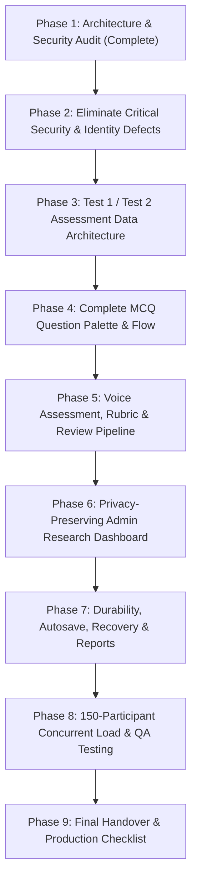

# Implementation and Test Plan
## Multimodal Psychometric AI Assessment Platform — 150-Participant Pilot Readiness

**Document Version:** 1.0.0  
**Date:** October 28, 2026  
**Auditor Roles:** Senior Software Architect, Application Security Engineer, Full-Stack Engineer, Database Engineer, QA & Deployment Specialist  
**Target Environment:** Controlled Pilot with 150 Real Engineering Student Participants  

---

## 1. Executive Summary & Audit Scope

This document provides a comprehensive code audit and execution roadmap for preparing the Multimodal Psychometric AI Assessment Platform for an on-premise, controlled pilot involving 150 real engineering participants across two test rounds (**Test 1** and **Test 2**).

The audit covered 100% of the active repository without speculative assumptions:
- **Backend Architecture:** Express 5.2.1 / Node.js CommonJS on `http://localhost:5000`
- **Frontend Architecture:** React 18.2.0 + Vite 8.2.2 SPA on `http://localhost:5173`
- **Database Layer:** MongoDB with Mongoose 9.6.2 (with dev-sandbox in-memory fallback)
- **Cryptographic Subsystem:** RSA-PSS SHA-256 digital signing with RFC 8785 canonical JSON
- **Biometric & Behavioral Proctoring:** WebRTC video/audio telemetry with Face-API.js (68-point landmarks)
- **AI/NLP Subsystem:** Provider-independent gateway (OpenAI / Gemini) with local rule-based psychometric fallback

---

## 2. Current Architecture & Component Mapping

### 2.1 Backend Component Map
```
backend/
├── config/
│   ├── db.js                      # MongoDB connection pool & event handlers
│   ├── env.js                     # Strict production fail-closed security policy
│   └── keys/                      # RSA-PSS keys (psychometric-key-2026-v1.priv/pub.pem)
├── controllers/
│   ├── adminController.js         # Admin overview, candidates roster, session audits
│   ├── assessmentController.js    # Adaptive session lifecycle, submitSession, getMySessions
│   ├── authController.js          # Candidate registration (student role enforced), login, JWT
│   ├── enrollmentController.js    # Academic/biometric enrollment, photo storage, identity check
│   ├── reportController.js        # Signed report generation, export artifact, public verification
│   └── resultController.js        # Legacy candidate results retrieval
├── middleware/
│   ├── authMiddleware.js          # JWT Bearer token validation & req.user injection
│   ├── errorMiddleware.js         # Production-safe error masks & audit logging
│   └── rbacMiddleware.js          # Role-based authorization ('student', 'admin', 'evaluator')
├── models/
│   ├── AssessmentSession.js       # Monolithic session doc (MCQ, voice, monitoring, report)
│   ├── AuditLog.js                # Tamper-evident security audit trails
│   ├── Enrollment.js              # Academic registration & reference face metadata
│   ├── Feedback.js                # Post-assessment user survey
│   ├── Question.js                # MongoDB question schema
│   ├── Result.js                  # Summarized score indicators and recommended roles
│   ├── SignedReport.js            # Cryptographic report records with canonical hashes
│   └── User.js                    # Account identity (bcrypt hashed passwords, role)
├── routes/
│   ├── adminRoutes.js             # Protected under authMiddleware + authorize("admin")
│   ├── assessmentRoutes.js        # Start, adaptive-question, record-answer, submit
│   ├── authRoutes.js              # /register, /login, /me, /profile
│   ├── complianceRoutes.js        # Zero-data egress audit statements
│   ├── enrollmentRoutes.js        # /create, /my, /reference-image/:key, /verify-identity
│   ├── healthRoutes.js            # /api/health (uptime, environment, version)
│   ├── reportRoutes.js            # /my, /verify, /keys, /:id/download, /performance-analysis
│   ├── resultRoutes.js            # /my, /:id
│   └── voiceRoutes.js             # /verify-sentence, /evaluate, /generate-probe
└── services/
    ├── adaptiveEngine.js          # Server-side question bank & difficulty adjustment
    ├── aiService.js               # External API & fallback verbal scoring
    ├── assessmentLifecycle.js     # State machine (STARTED -> IN_PROGRESS -> COMPLETED)
    ├── auditLogger.js             # Security event recording
    ├── digitalSignatureService.js # RSA-PSS SHA-256 signing & RFC 8785 canonicalization
    ├── identityStorageService.js  # SHA-256 hashed disk storage for reference images
    ├── identityVerificationService.js # Face count, liveness, & matching validation
    ├── mediaRetentionService.js   # 5-minute ephemeral audio cleaner
    ├── overallReportService.js    # Report aggregation & cryptographic binding
    ├── performanceAnalysisService.js # Longitudinal score progression engine
    └── psychometricEngine.js      # Patent formula implementation & readiness indexes
```

### 2.2 Frontend Component Map
```
frontend/src/
├── api/
│   ├── apiClient.js               # Consolidated API client (auth, enrollment, assessment, reports)
│   └── axios.js                   # Axios instance with Authorization Bearer interceptor
├── components/
│   ├── AdaptiveAssessment.jsx     # Live candidate MCQ interface with Proctoring Monitor
│   ├── AssessmentSetup.jsx        # Role selection & starting difficulty configuration
│   ├── BehavioralBaseline.jsx     # 45-second keystroke & mouse dynamics calibration
│   ├── DeviceValidation.jsx       # Camera, microphone, WebRTC, secure context checks
│   ├── IdentityVerification.jsx   # Live webcam capture & face enrollment verification
│   ├── MCQTest.jsx                # [DEFECTIVE/LEGACY] Hardcoded client questions & scoring
│   ├── Navbar.jsx                 # Top-level navigation with role-aware route links
│   ├── PerformanceAnalysis.jsx    # Historical progression charts across attempts
│   ├── RealtimeMonitor.jsx        # Canvas-based face presence & gaze proctoring widget
│   ├── SignedReportViewer.jsx     # Official digital certificate display & JSON download
│   └── VoiceInterview.jsx         # Web Speech API speech-to-text with AI follow-up probe
├── pages/
│   ├── AdminDashboard.jsx         # Overview metrics, candidate roster, session drilldown
│   ├── AssessmentFlow.jsx         # 5-step multistage wizard manager
│   ├── Dashboard.jsx              # Candidate hub with previous attempt history & launch
│   ├── Landing.jsx                # Public landing page with patent summary
│   ├── Login.jsx                  # Candidate & admin authentication form
│   ├── Register.jsx               # Candidate registration with live head orientation check
│   ├── ReportVerification.jsx     # Public drag-and-drop JSON signature verification portal
│   └── Results.jsx                # Post-assessment multimodal breakdown & report link
└── data/
    ├── questionBank.js            # [DEFECTIVE/LEAK] Leaks MCQ answers & questions to bundle
    └── questions.js               # [DEFECTIVE/LEAK] Hardcoded questions with answers in client
```

---

## 3. Critical Defects & Immediate Vulnerabilities

The audit identified five critical defects that violate pilot reliability, security, and academic validity:

### Defect 1: Synthetic/Deterministic Face-Matching Fallback
- **Location:** [`backend/services/identityVerificationService.js#L96-L105`](file:///P:/psychometric-patent/psychometric-system-backup/backend/services/identityVerificationService.js#L96-L105)
- **Defect:** When external face matching is unavailable, the code computes a SHA-256 hash difference between the first 500 bytes of the reference photo and the live capture:
  ```javascript
  const diffCount = Math.abs(parseInt(refHash.slice(0, 8), 16) - parseInt(liveHash.slice(0, 8), 16));
  matchScore = Math.max(75, Math.min(99, 95 - (diffCount % 20)));
  ```
  This creates a completely fabricated face-similarity score between 75% and 95%, allowing arbitrary live images to pass verification!
- **Violation:** Master Rule 6 & Phase-2 Requirement 1. Missing or unverified face matching must fail closed.

### Defect 2: Client-Supplied Verification Values Accepted Without Server Proof
- **Location:** [`backend/services/identityVerificationService.js#L24-L28`](file:///P:/psychometric-patent/psychometric-system-backup/backend/services/identityVerificationService.js#L24-L28), [`frontend/src/pages/AssessmentFlow.jsx#L148-L153`](file:///P:/psychometric-patent/psychometric-system-backup/frontend/src/pages/AssessmentFlow.jsx#L148-L153)
- **Defect:** `livenessScore = 0.85`, `faceCount = 1`, and `faceSimilarity` are accepted from the HTTP request body. In `AssessmentFlow.jsx`, the browser submits `identity: { verified: true, livenessCheck: "verified" }`.
- **Violation:** The browser must never dictate identity verification or liveness truth.

### Defect 3: Answer-Key Leakage in Frontend Bundle
- **Location:** [`frontend/src/data/questionBank.js`](file:///P:/psychometric-patent/psychometric-system-backup/frontend/src/data/questionBank.js), [`frontend/src/data/questions.js`](file:///P:/psychometric-patent/psychometric-system-backup/frontend/src/data/questions.js), [`frontend/src/components/VoiceInterview.jsx#L2`](file:///P:/psychometric-patent/psychometric-system-backup/frontend/src/components/VoiceInterview.jsx#L2)
- **Defect:** `VoiceInterview.jsx` imports `questionBank.js`. This file contains both voice prompts AND MCQs with raw answer indices (`answer: 1`, `answer: 2`). Compiling Vite includes all correct answers in client JavaScript assets (`assets/index-*.js`).
- **Violation:** Candidates inspecting DevTools network/source tabs can extract all answer keys.

### Defect 4: Administrator Portal Exposing Prohibited Personal Data
- **Location:** [`backend/controllers/adminController.js#L100`](file:///P:/psychometric-patent/psychometric-system-backup/backend/controllers/adminController.js#L100), [`backend/controllers/adminController.js#L162`](file:///P:/psychometric-patent/psychometric-system-backup/backend/controllers/adminController.js#L162), [`frontend/src/pages/AdminDashboard.jsx#L339-L345`](file:///P:/psychometric-patent/psychometric-system-backup/frontend/src/pages/AdminDashboard.jsx#L339-L345)
- **Defect:** 
  1. `getCandidates` executes `User.find(query).select("-password")`, exposing personal emails, college, branch, and registration timestamps.
  2. `getSessions` returns full candidate answers, transcripts, and proctoring telemetry linked directly to candidate names and emails.
- **Violation:** Master Non-Negotiable Access Policy: Administrators may only view candidate name and roll number for identification. No personal email, individual answers, or scores linked to identities may be exposed.

### Defect 5: Missing Test 1 vs Test 2 Assessment Modeling
- **Location:** [`backend/models/AssessmentSession.js`](file:///P:/psychometric-patent/psychometric-system-backup/backend/models/AssessmentSession.js), [`backend/models/Result.js`](file:///P:/psychometric-patent/psychometric-system-backup/backend/models/Result.js)
- **Defect:** The system models a single flat session history without distinguishing Test 1 (Pre-Assessment) vs Test 2 (Post-Assessment) or Cohort / Group assignments. If a candidate retakes an assessment, attempts are unversioned and cannot be filtered or compared test-wise.
- **Violation:** Phase-3 & Phase-6 requirements for paired longitudinal research.

---

## 4. Security & Privacy Risks

| Risk Identifier | Severity | Component | Description | Remediation Plan |
| :--- | :--- | :--- | :--- | :--- |
| **SEC-01** | **CRITICAL** | `identityVerificationService.js` | Hash-based pseudo face matching creates false authentications. | Fail-closed or require genuine descriptor comparison; flag unverified sessions as `PENDING_REVIEW`. |
| **SEC-02** | **HIGH** | `enrollmentRoutes.js#L18` | `GET /reference-image/:key` lacks IDOR ownership check; any candidate token can access any stored face key. | Add candidate ID / ownership check to storage key lookups. |
| **SEC-03** | **HIGH** | Frontend Assets | Question bank and answer keys bundled in client JS via `questionBank.js`. | Separate voice prompts from MCQ bank; delete client-side MCQ answer keys entirely. |
| **SEC-04** | **HIGH** | `adminController.js` | Admin endpoints return full candidate profiles and session answers linked to identity. | Restrict projection strictly to `name` and `rollNumber`. Use anonymous IDs for response audit. |
| **SEC-05** | **MEDIUM** | `mediaRetentionService.js` | Flat file sweep in `uploads/` risks deleting subdirectories if recursively executed. | Enforce directory guards so `uploads/identity_references/` is never touched by the 5-minute audio purge. |
| **SEC-06** | **MEDIUM** | `digitalSignatureService.js` | RSA private key stored in `backend/config/keys/`. | Support environment variable injection for private keys; ensure Git excludes private keys. |

---

## 5. Missing Features Required for 150-Participant Pilot

1. **Dual-Test & Cohort Architecture (Phase-3):**
   - Distinct `testId` ("TEST_1", "TEST_2") and `testVersion` (e.g. "v1.0").
   - Explicit attempt numbering (`attemptNumber: 1, 2`) with immutable attempt preservation.
   - Cohort/Group partitioning (e.g. "Cohort-A", "Control-Group").
2. **Accessible MCQ Question Palette (Phase-4):**
   - Interactive question grid with 4 clear states: Current, Answered, Unanswered, Marked for Review.
   - Section navigation, return navigation, and autosave state indicator.
3. **Voice Rubric & Review Workflow (Phase-5):**
   - Explicit multidimensional rubric: Problem Analysis, Technical Depth, Practicality, Communication, Adaptability, Ethical Judgment.
   - AI proposal vs Human reviewer score override workflow with anonymous response IDs.
4. **Administrator Research Dashboard (Phase-6):**
   - Aggregate distributions (MCQ question-level difficulty, voice dimension means).
   - Test 1 vs Test 2 paired comparison statistics with sample denominators ($N$).
   - Participant directory displaying strictly Name and Roll Number.
   - Authorized aggregate CSV/JSON research exports excluding prohibited personal data.
5. **Autosave, Offline Queue, & Recovery (Phase-7):**
   - Robust answer caching in `sessionStorage` / `IndexedDB` with automatic retry on connection restoration.
   - Idempotent submission keys to eliminate duplicate finalization under 150-participant concurrency.

---

## 6. Ordered Implementation Roadmap



### Phase Breakdown

- **Phase-2 (Security & Scoring Integrity):**
  - Replace deterministic hash matching with fail-closed face verification.
  - Fix IDOR on `/api/enrollment/reference-image/:key`.
  - Remove client question banks and answer keys from frontend.
  - Enforce ownership on all candidate-scoped endpoints.
- **Phase-3 (Assessment Data Architecture):**
  - Implement `TestDefinition` and `AssessmentAttempt` schemas.
  - Add support for Test 1, Test 2, and Cohort grouping without data overwrites.
  - Create safe, backward-compatible database migration scripts.
- **Phase-4 (MCQ Palette & Navigation):**
  - Build responsive question palette with Answered, Unanswered, Marked-for-Review.
  - Connect strictly to server-delivered questions (`/api/assessment/question`).
  - Implement attempt resume and technical timer synchronization.
- **Phase-5 (Voice Evaluation & Human Review):**
  - Structure 6-dimension rubric in `aiService.js` and `voiceRoutes.js`.
  - Implement AI score proposal with reviewer override capabilities.
  - Ensure anonymous response IDs are used during evaluation.
- **Phase-6 (Privacy-Compliant Admin Analytics):**
  - Redesign `AdminDashboard.jsx` and `adminController.js` to strictly enforce the privacy boundary.
  - Build aggregate charts for Test 1 vs Test 2 comparison.
  - Implement research export endpoints (CSV/JSON).
- **Phase-7 (Reliability, Low-Bandwidth & Signatures):**
  - Implement network-resilient autosave and offline response buffering.
  - Refine key rotation and cryptographic signature verification.
  - Validate media retention policies and cleanup behavior.
- **Phase-8 (Release QA & 150-User Load Testing):**
  - Execute automated regression suite across all 8 test modules.
  - Conduct synthetic load testing (10, 25, 50, 100, 150 concurrent simulated candidates).
  - Verify API p95 < 2.0s, submission p95 < 3.0s, 0% cross-participant leakage.
- **Phase-9 (Handover Audit & Launch Readiness):**
  - Perform clean-room verification, documentation synchronization, and launch checklist.

---

## 7. Commands to Run & Verify Each Phase

### Operational Lifecycle Commands
| Purpose | Command | Working Directory |
| :--- | :--- | :--- |
| **Backend Test Suite** | `npm test` | `backend/` |
| **E2E Cryptographic Test** | `node tests/e2e_full_verification.js` | `backend/` |
| **Start Backend API** | `node server.js` | `backend/` |
| **Frontend Production Build** | `npm run build` | `frontend/` |
| **Start Frontend Dev** | `npm run dev` | `frontend/` |
| **Health Endpoint Check** | `curl -s http://localhost:5000/api/health` | Anywhere |

---

## 8. Pilot Acceptance Criteria (150 Real Participants)

1. **Zero Answer Key Leakage:** No MCQ answer keys or scoring constants in client bundles.
2. **Fail-Closed Biometrics:** Inability to match a face must enter `PENDING_REVIEW` instead of fabricating success.
3. **Data Protection Boundary:** Administrators can never view email, phone, individual answers, or biometric keys linked to candidate names.
4. **Test 1 & Test 2 Integrity:** Both tests recorded independently without data loss or record overwrites.
5. **Autosave Recovery:** Browser reload or brief disconnection restores candidate progress seamlessly.
6. **Performance Envelope:** Under 150 concurrent participants:
   - Routine API response time: p95 $\le$ 2.0s
   - Final submission response time: p95 $\le$ 3.0s
   - Unexpected request failures: < 1.0%

---
*Implementation and Test Plan established. Proceeding to Phase-2 implementation upon user prompt.*
